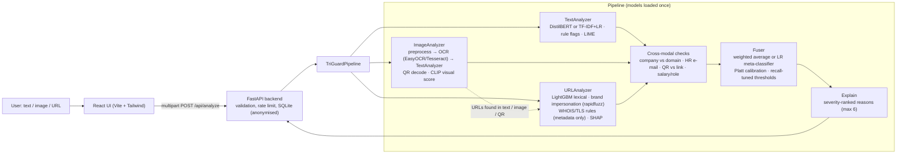

# TriGuard — Multimodal Fake Job & Internship Scam Detector

> **Verify before you apply.** TriGuard takes any combination of job/internship **text**, an **image** (offer letter, poster, screenshot)
> and an **application URL**, and returns a label (**Safe / Suspicious / Likely Scam**), a calibrated risk score (0–100%) and
> plain-English reasons (red flags) — including whether the three inputs *agree with each other*.

Final-year project, Team 3, Data Mining & Bigdata MRG. Extends Pillai (2023), *Detecting Fake Job Postings Using Bidirectional LSTM*
(text-only, EMSCAD), with image/OCR, URL analysis, cross-modal consistency checks, calibration and explanations.

> **Status:** the full system is implemented and tested, but all models and every number in `backend/reports/` were produced on **SYNTHETIC stand-in data**
> because the real datasets and GPU-trained models were not available. See [PROGRESS.md](PROGRESS.md) → *WAITING FOR USER* for what to add and which scripts to re-run.

## Architecture



Every analyzer returns the same `ModalityResult` (`modality, probability, red_flags, extracted, explanation, available`); the pipeline returns a `FinalResult`
(`label, risk_score, modality_results, reasons, cross_modal_flags`) — see [backend/ml/common/schemas.py](backend/ml/common/schemas.py).

## Setup

Python 3.11 is the target (3.12 also works), Node 20+.

The repo has two **independent, self-contained folders**: `backend/` (API + ML, own venv, tests, data, models, Dockerfile) and `frontend/` (React app, own Dockerfile).
They only talk over HTTP (`/api/*`).

```bash
# Backend / ML  (everything below is run from backend/)
cd backend
python3 -m venv .venv && source .venv/bin/activate
pip install -r requirements.txt          # large (torch, easyocr, transformers)
# macOS only: brew install libomp zbar tesseract   (LightGBM, QR decoding, OCR fallback)
pytest                                    # 232 tests

# Frontend  (separate terminal)
cd frontend && npm install && npm test && npm run build
```

### Run
```bash
(cd backend && uvicorn app.main:app --reload)   # API  http://127.0.0.1:8000  (docs at /docs)
cd frontend && npm run dev                 # UI   http://localhost:5173  (proxies /api to :8000)
# or everything in containers:
docker compose up --build                  # UI http://localhost:8080 · API http://localhost:8000   (models mounted from ./backend/models)
# or run each side alone:  docker build -t triguard-backend backend  ·  docker build -t triguard-frontend frontend
```
Environment variables: `TRIGUARD_DB_URL`, `TRIGUARD_CORS`, `TRIGUARD_RATE_LIMIT`, `TRIGUARD_TIMEOUT_S`, `TRIGUARD_LIVE_CHECKS` (0 disables WHOIS/TLS),
`TRIGUARD_OCR_BACKEND` (auto|easyocr|tesseract). Deployment on free tiers: [docs/deploy.md](docs/deploy.md).

## Training / reproduction steps

1. **Data** → `backend/data/raw/`: `fake_job_postings.csv` (Kaggle "Real / Fake Job Posting Prediction"), optional `custom_text.csv` (template in `backend/data/raw/custom_text_template.csv`),
   `urls/*.csv` (PhishTank / Kaggle malicious_phish), real images in `backend/data/images/{scam,genuine}/`, aligned cases in `backend/data/aligned/aligned.csv` ([format](backend/data/aligned/README.md)).
   (Run all commands in steps 2–5 from `backend/`.) Missing pieces are replaced by clearly-marked `SYNTHETIC_*` data so everything still runs.
2. **Prepare**: `python -m ml.text.prepare_emscad && python -m ml.text.prepare_custom && python -m ml.url.prepare_urls && python -m ml.image.prepare_images`
   (dedupe *before* stratified 70/15/15 split, seed 42).
3. **Train**: `python -m ml.text.baselines` (TF-IDF+LR and Bi-LSTM reproduction) · `python -m ml.url.train` (LightGBM) ·
   `python -m ml.fusion.train_fuser` (meta-classifier; only installed when trained on a real `aligned.csv`).
4. **GPU models (Colab)**: run `backend/ml/notebooks/text_distilbert_colab.ipynb` → unzip into `backend/models/text_distilbert/`; run `backend/ml/notebooks/image_clip_colab.ipynb` → `backend/models/image_clip/`.
   They are picked up automatically; nothing else changes.
5. **Evaluate**: `python -m ml.image.compare_ocr && python -m reports.evaluate_all [--with-bilstm-cv]` → [backend/reports/RESULTS.md](backend/reports/RESULTS.md), `backend/reports/error_analysis.md`, `backend/reports/figures/`.

## API

| Method & path | Purpose |
|---|---|
| `POST /api/analyze` | multipart form: `text?`, `url?`, `image?` (PNG/JPEG/WebP ≤ 5 MB). Returns `FinalResult` + `id`, `latency_ms`. 400 if no input. |
| `POST /api/feedback` | `{"analysis_id": 1, "correct": true, "comment": "…"}` |
| `GET /api/history` | last 20 analyses (anonymised) |
| `GET /api/stats` | totals, label counts, average risk/latency, feedback accuracy |
| `GET /health` | liveness + loaded text model + fusion mode |

```bash
curl -F "text=Pay Rs 2000 registration fee, no interview" -F "url=http://tcs-hiring.online/apply" -F "image=@letter.png" http://127.0.0.1:8000/api/analyze
```
Errors always look like `{"error": {"code": "no_input", "message": "…", "request_id": "…"}}` (codes: `no_input`, `image_too_large` 413, `unsupported_image_type` 415,
`unusable_input` 422, `rate_limited` 429, `timeout` 504, …).

## Results

The base paper reports Bi-LSTM F1 0.86 / recall 0.83 on EMSCAD (and an AUROC that appears to be computed from hard labels; our evaluation reports AUCs from probabilities only).
[backend/reports/RESULTS.md](backend/reports/RESULTS.md) contains: 5-fold CV (mean ± std), base-paper comparison, ablation (text / URL / image / pairs / all three / + cross-modal),
EMSCAD → Indian generalisation, OCR character-error-rate, calibration (ECE) and confusion matrices / PR curves, plus [error analysis](backend/reports/error_analysis.md).

**Current numbers are from synthetic data and must not be quoted**; they are placeholders that prove the pipeline works end to end. Re-run step 5 after adding real data.

## Limitations
- No real EMSCAD / URL / aligned data or GPU-trained DistilBERT/CLIP were available during development; stand-in models are over-confident outside their synthetic training distribution
  (e.g. a short genuine posting can score "Suspicious").
- EMSCAD is English, US-centric and old; Indian scam wording (UPI, WhatsApp/Telegram, Aadhaar/PAN) is covered mainly by rules until real Indian data is added.
- Domain age (WHOIS) and TLS lookups are best-effort with 3 s timeouts and can fail; they act only as inference-time rules, never as training features.
- OCR quality drops on low-resolution phone photos; Hindi OCR is available in EasyOCR but not enabled by default.
- Rate limiter, history and stats are in-memory/global (single process, no accounts).
- Scores are decision support, not proof. A "Safe" label is not a guarantee.

## Ethics & privacy
- Suspicious URLs are **never opened or rendered** — only string analysis and metadata lookups (WHOIS, TLS handshake, `HEAD` on known shorteners with an SSRF guard).
- Uploaded images are processed **in memory** and never written to disk; only a SHA-256 hash is stored. QR codes are decoded, not visited.
- Stored text is **anonymised** (phones, e-mails, Aadhaar/PAN-like IDs masked); the `/api/history` view shows only masked data.
- A false "Likely Scam" can hurt a legitimate employer and a false "Safe" can hurt a candidate; the UI states this and tells users to verify via official channels and to report fraud at cybercrime.gov.in / 1930.
- Datasets must be used under their licences; do not commit raw data (`data/raw/`, `models/` are gitignored).

## Repository layout
```
backend/                   self-contained API + ML project
  app/                     FastAPI app (routes, db, security, errors)
  ml/common|text|url|image|fusion   analyzers, training scripts, cross-modal checks, fuser, explanations
  ml/pipeline.py           TriGuardPipeline
  ml/notebooks/            Colab notebooks (DistilBERT, CLIP)
  data/ models/ reports/   datasets (gitignored), saved models (gitignored), evaluation outputs
  tests/ scripts/ demo_assets/  pytest suite, helper scripts, demo image
  requirements.txt  pytest.ini  Dockerfile
frontend/                  React + Vite + TS + Tailwind (Vitest tests, Dockerfile, nginx.conf)
docs/                      PHASES.md, deploy.md, demo_script.md
docker-compose.yml         runs both together
```

## Team
Team 3 — Data Mining & Bigdata MRG. _(add member names and supervisor here)_

## References
Pillai, S. (2023). *Detecting Fake Job Postings Using Bidirectional LSTM.* · EMSCAD (Employment Scam Aegean Dataset) / Kaggle "Real / Fake Job Posting Prediction".
