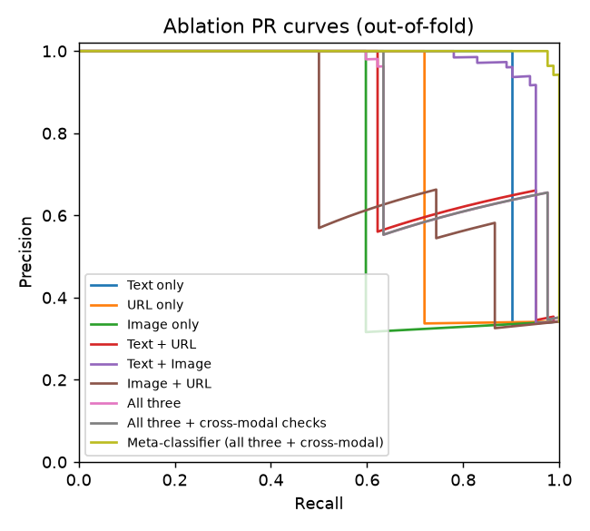
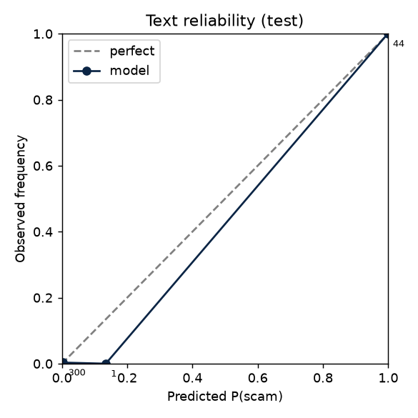
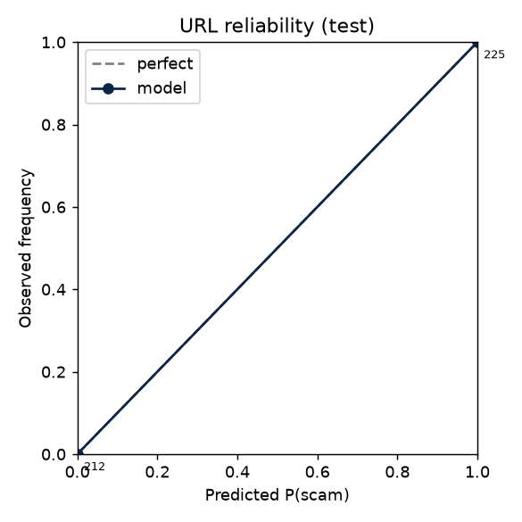
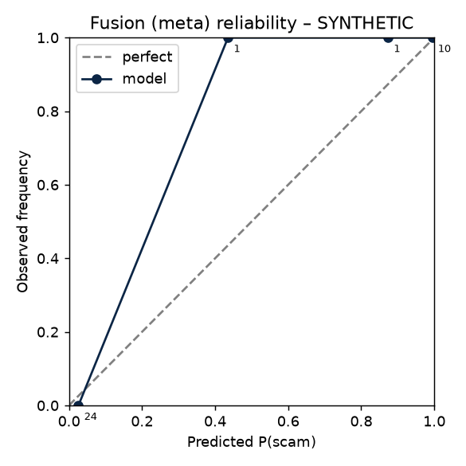
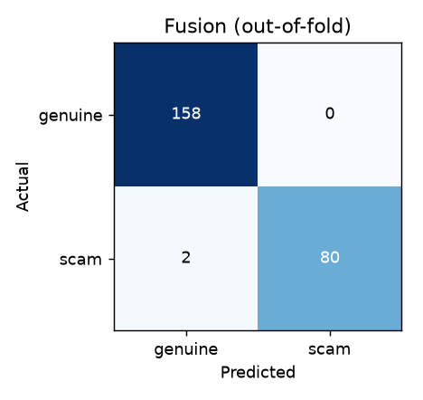
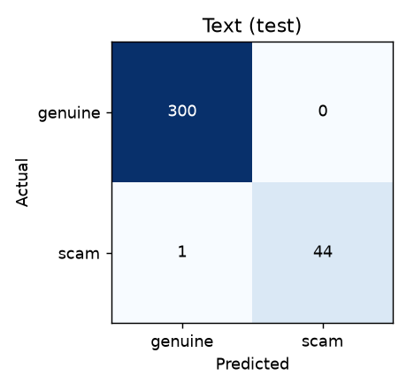
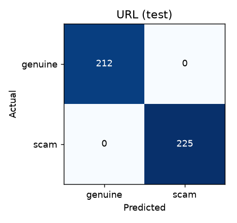
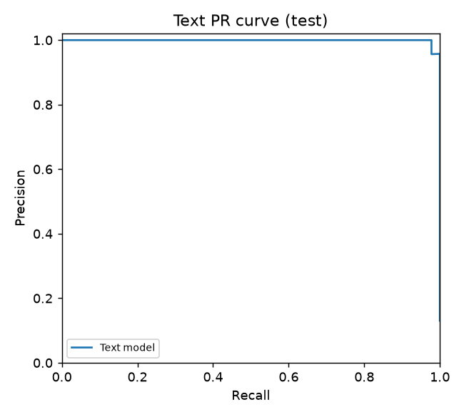
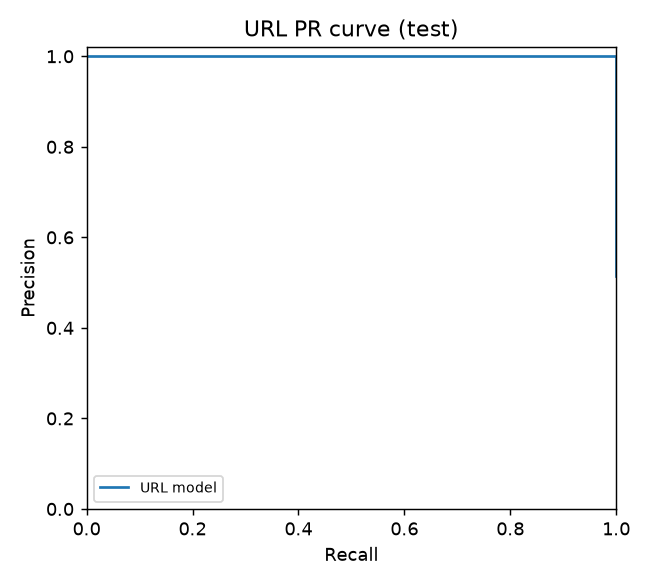

# TriGuard – results

> **WARNING – SYNTHETIC DATA.** Sections marked 🧪 were computed on generated stand-in data (text: True, URL: True, aligned set: True). Do not quote them as scientific results; rerun `python -m reports.evaluate_all` after adding the real datasets (see PROGRESS.md → WAITING FOR USER).

## 1. 5-fold stratified cross-validation (mean ± std) 🧪 SYNTHETIC

| Model | precision | recall | f1 | pr_auc | roc_auc | mcc |
|---|---|---|---|---|---|---|
| TF-IDF + LR | 0.997 ± 0.007 | 0.967 ± 0.024 | 0.981 ± 0.010 | 0.997 ± 0.004 | 0.999 ± 0.002 | 0.979 ± 0.011 |
| Bi-LSTM (base-paper reproduction) | 1.000 ± 0.000 | 0.940 ± 0.027 | 0.969 ± 0.014 | 0.995 ± 0.006 | 0.998 ± 0.003 | 0.965 ± 0.016 |
| LightGBM (lexical) | 1.000 ± 0.000 | 1.000 ± 0.000 | 1.000 ± 0.000 | 1.000 ± 0.000 | 1.000 ± 0.000 | 1.000 ± 0.000 |

Thresholds and Platt calibration are fitted inside each fold on a 15% validation split; vectorizers/tokenizers fit on the training part only.

## 2. Comparison with the base paper (EMSCAD test split) 🧪 SYNTHETIC

| Model | F1 | Recall | ROC-AUC (probabilities) | ROC-AUC (hard labels) | PR-AUC |
|---|---|---|---|---|---|
| Pillai (2023) – reported Bi-LSTM | 0.860 | 0.830 | n/a | n/a | n/a |
| Ours: Bi-LSTM reproduction | 0.989 | 0.978 | 1.000 | 0.989 | 1.000 |
| Ours: text_tfidf_lr | 0.989 | 0.978 | 1.000 | 0.989 | 0.999 |
| Ours: DistilBERT | pending (Colab) | pending | pending | pending | pending |

The base paper reports AUROC apparently computed from hard (0/1) predictions; the two AUROC columns show how much that choice changes the number for our models.

## 3. Ablation on the aligned multimodal set (out-of-fold, n=240) 🧪 SYNTHETIC

| Configuration | Coverage | Precision | Recall | F1 | PR-AUC | ROC-AUC |
|---|---|---|---|---|---|---|
| Text only | 92% | 0.349 | 0.902 | 0.503 | 0.936 | 0.906 |
| URL only | 73% | 1.000 | 0.720 | 0.837 | 0.815 | 0.757 |
| Image only | 65% | 0.316 | 0.598 | 0.414 | 0.735 | 0.664 |
| Text + URL | 99% | 0.661 | 0.951 | 0.780 | 0.842 | 0.870 |
| Text + Image | 96% | 0.348 | 0.951 | 0.510 | 0.962 | 0.949 |
| Image + URL | 91% | 0.663 | 0.744 | 0.701 | 0.767 | 0.783 |
| All three | 100% | 0.648 | 0.963 | 0.775 | 0.850 | 0.886 |
| All three + cross-modal checks | 100% | 0.650 | 0.976 | 0.780 | 0.851 | 0.886 |
| Meta-classifier (all three + cross-modal) | 100% | 1.000 | 0.976 | 0.988 | 0.999 | 0.999 |

Coverage = share of cases where the configuration has at least one input. Thresholds are tuned on each fold's training part. 

## 4. Generalisation: EMSCAD-trained text model → Indian set 🧪 SYNTHETIC

| Set | Variant | Precision | Recall | F1 | PR-AUC | ROC-AUC | MCC |
|---|---|---|---|---|---|---|---|
| EMSCAD test | model only | 1.000 | 0.978 | 0.989 | 0.999 | 1.000 | 0.987 |
| EMSCAD test | model + rules | 1.000 | 0.978 | 0.989 | 1.000 | 1.000 | 0.987 |
| Indian custom | model only | 0.544 | 1.000 | 0.705 | 1.000 | 1.000 | 0.000 |
| Indian custom | model + rules | 0.544 | 1.000 | 0.705 | 1.000 | 1.000 | 0.000 |

Threshold fixed from EMSCAD validation; a gap between ROC/PR-AUC (ranking) and F1 (threshold) indicates calibration shift rather than lost signal.

## 5. OCR comparison (character error rate)

> **SYNTHETIC images.** Clean rendered letters; real phone photos will be much harder. Replace `data/images/ocr_gt.csv` (path,text) with real annotated images and re-run.

Images: 20

| Backend | Preprocessing | Mean CER | Median CER | s/image |
|---|---|---|---|---|
| easyocr | raw grayscale | 0.039 | 0.038 | 1.54 |
| easyocr | preprocessed | 0.042 | 0.048 | 2.35 |
| easyocr | preprocessed + binarised | 0.042 | 0.043 | 2.21 |
| tesseract | raw grayscale | 0.002 | 0.000 | 0.21 |
| tesseract | preprocessed | 0.002 | 0.000 | 0.31 |
| tesseract | preprocessed + binarised | 0.002 | 0.000 | 0.28 |

## 6. Calibration (ECE) 🧪 SYNTHETIC

| Model | ECE before calibration | ECE after Platt scaling |
|---|---|---|
| Text (TF-IDF+LR) | 0.014 | 0.001 |
| URL (LightGBM) | 0.000 | 0.000 |

  

## 7. Confusion matrices & PR curves

     

## 8. Error analysis

See [error_analysis.md](error_analysis.md) (10 examples).
